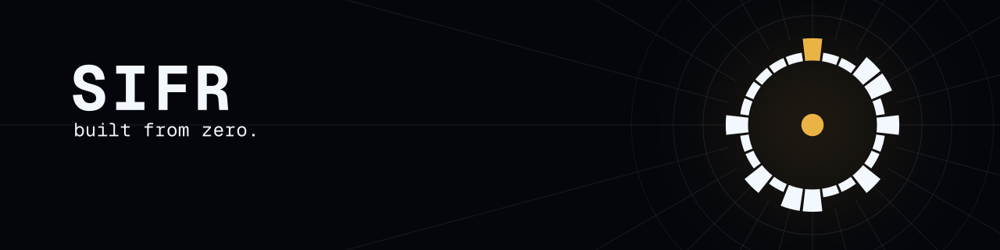

# cipher

Cipher is an original native Linux windowing and graphics framework, written from the wire up in Zig. Part of SIFR: precision, reduction to essentials, mathematical structure, clarity.

**Status:** the Wayland wire client is handwritten and verified end-to-end on a live compositor: registry, xdg-shell toplevel, shared-memory surface, full configure → frame callback → commit → teardown cycle. No protocol code is generated, no library is linked, no C dependency exists anywhere in the tree.

## What exists today

| Component | State |
|---|---|
| `src/wayland.zig` | Raw Wayland wire client: `wl_display` marshaling, `wl_registry`, `wl_compositor`, `wl_shm` (memfd + `SCM_RIGHTS`), `wl_surface`, `xdg_wm_base`, `xdg_surface`, `xdg_toplevel` — hand-encoded from the upstream XML semantics |
| `src/geometry.zig` | 24-cell cipher-ring geometry, unit-tested |
| `src/render.zig` | CPU rasterizer for the SIFR ring; A8R8G8B8 pixels, PPM evidence dump |
| `src/main.zig` | App lifecycle: connect → bind → configure → render/commit/frame-callback loop |

## Requirements

- Zig 0.17.1
- Linux with a running Wayland compositor (verified on `wayland-0`)
- No other dependencies — not GTK, not X11, not libwayland. The kernel's syscall layer is the only floor.

## Build, test, run

```bash
zig build test   # ring geometry + rasterizer tests
zig build        # debug binary
zig build -Doptimize=ReleaseFast

./zig-out/bin/cipher --frames 24
```

`--frames N` runs N frames then exits cleanly; the terminal prints `WAYLAND_PROTOCOL_OK frames=N`. An SPPM dump of the final frame is written to `/tmp/opencode/cipher_frame.ppm` for evidence.

## Built from zero — what that means here

No generated protocol bindings, no external crates/packages, no FFI to a toolkit. The Wayland client is marshaling over `AF_UNIX` sockets and `memfd_create`. The rendering is ours. The only planned third-party runtime surfaces, if any, will be system GPU driver API entry points (and only ever reached through our own loader) — nothing will sit between Cipher and the hardware beyond the driver itself.

## Roadmap

1. Wayland window + verified frame loop (done)
2. Input: `wl_seat`/`wl_keyboard`/`wl_pointer` — actions and focus
3. Software present path (current) and GPU present path via our own Vulkan/OpenGL loader
4. Scene graph, render graph, batching, text (own TrueType reader, glyph atlas), layout (flexbox), motion
5. `mobilis` terminal and `harmonis` music player built on Cipher
6. Accessibility: own tree first, `AT-SPI2` bridge later — never via a toolkit

## License

Not declared yet; the owner will select one before public release.
